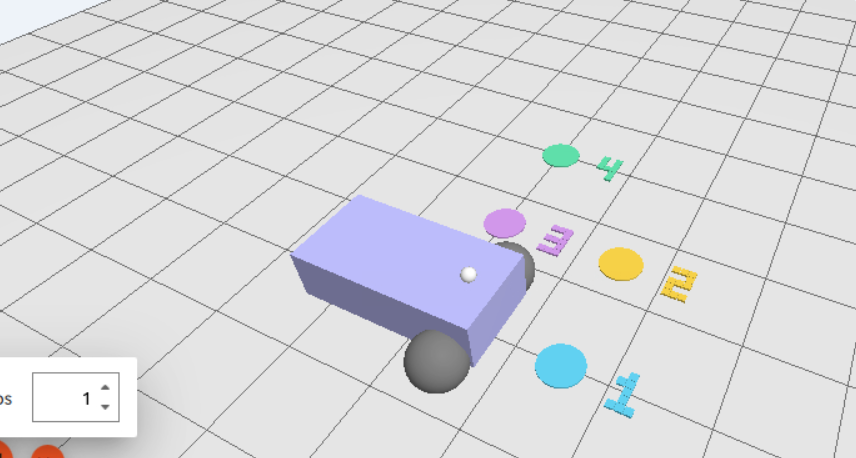

# 2026-10-28〜29 本人操作によるハンズオン確認

本人がコマンドを入力し、出力と実際の画面を確認しながら、公開用フォルダで再現した記録です。元の2026-10-26の録画や、2026-10-27のパッケージ確認とは別の試行です。

## 確認できたこと

Docker Compose v5.1.1、Linuxコンテナ、環境確認の `ok: true`、既存の走行判定テスト7件の成功を確認しました。保存モデルのハッシュは元のモデルと一致しています。

| 試行 | 走行 | 録画 | 最終距離 | シミュレーション秒 / 実秒 |
|---|---|---|---|---|
| GUIなし | 4点・停止成功 | 対象外 | 0.167849 m | 24.728 / 63.075 |
| GUIあり take1 | 4点・停止成功 | 0バイトで失敗 | 0.168465 m | 24.659 / 93.368 |
| GUIあり take2 | 4点・停止成功 | 保存・再生成功 | 0.159396 m | 24.645 / 103.179 |

take2の各点への採点距離は0.194366、0.195750、0.192679、0.187013 mで、すべて0.25 m以内。最終速度は0 m/s・0 rad/s、停止保持はCSV上1.011シミュレーション秒でした。

take2はH.264、982×584、132.136秒、5,397,391バイトです。保存後のffprobe検証が成功し、本人が動画を再生して白い点の1→2→3→4の移動と最終停止を目視確認しました。

根拠データは [handson_records/](handson_records/) に保存しています。録画本体は手元で管理し、公開用コードへは同梱しません。

## 見つかった問題と修正

1. 通常のGUI一括起動で、サーバーがGUIの開始指示を待ち、GUIが世界一覧を待ち続けました。サーバーを `-s` で先に起動し、GUIを `-g` で後から接続すると車体・4つの目標・白い基準点が表示されました。起動補助もこの分離方式に変更しました。本人が修正後の `python3 start_demo.py --waypoints` を実行し、gazebo・bridge・guiの3プロセスの起動と、車体・4つの目標・白い点の表示を再確認しました。
2. rootで作成したROSログへubuntuユーザーで書けず、権限エラーが発生しました。教材内で制御する端末はrootにそろえる説明を追加しました。
3. デスクトップ幅981ピクセルがH.264/YUV420Pの偶数条件を満たさず、take1の録画が失敗しました。録画コードを修正し、右端・下端へ最大1ピクセルの余白を加えます。また、保存後の終了状態・動画形式・寸法・正の再生時間を検証してから `Saved` を表示します。take2はこの修正で録画できました。

録画の回帰確認は3件成功しました。奇数サイズのRGBテスト映像を実際にH.264へ変換・ffprobeで検証し、空ファイルとエンコーダーの異常終了を成功扱いしないことも確認しました。



## 検証範囲

このPC上の保存済みイメージによる確認です。新規PCへの初回導入、異なるCPUアーキテクチャ、別コースの汎化、説明付き動画の合成補助は未検証です。

## 学習からの再実行（2026-10-29）

本人が学習用環境の `ok: true` を確認し、別フォルダで `train_policy.py` を実行しました。教師データ生成24,000状態、別seedの検証6,000状態、CPU 1スレッド、Adam、学習率0.002、バッチ512、1,800更新を再現しています。

- 更新区間の実時間：11.467秒。
- 検証用の速度平均絶対誤差：前進0.007062 m/s、旋回0.004081 rad/s。
- PyTorchとNumPy出力の最大差：4.3213e-7（判定上限1e-5以下）。
- 生成した教師データの全配列は、元データと一致。
- 新しい重みファイルのSHA256は提出モデルと一致し、バイト単位で同一。

```text
fa0ba22da8d10f839862cd06157fed283af6209e72b5f6b9bb2e7b2b2887a6b4
```

[学習メトリクス](handson_records/retraining_20261029/training_metrics.json)、[学習曲線](handson_records/retraining_20261029/training_curve.csv)、[照合記録](handson_records/retraining_20261029/verification.json) を保存しました。元の提出モデルは保持しています。

学習後の20/20は簡易な運動計算の結果で、Gazebo走行の試行数とは分けます。今回の再学習結果は、すでにGUIなし・GUIありで走行を確認した重みと同一です。
