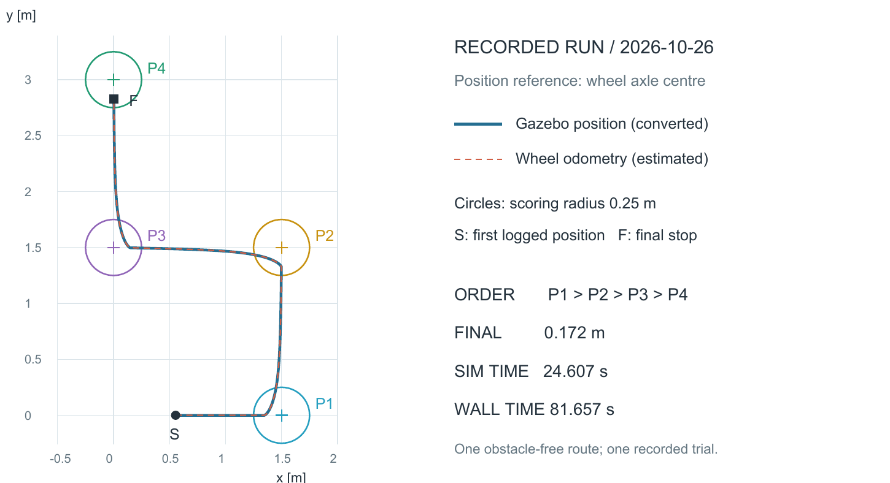

# 軽量な模倣学習による3D移動ロボットの4点通過

Physical AI 応用1講座 最終課題 / OmniCampus：ID88589 / 2026-10-29

使用コード・再現手順：

https://github.com/moshums-afk/physical-ai-four-point-navigation

動作動画：

https://youtu.be/YEbQuHdJQwY

## 1. 概要と目的

Gazeboの3D空間で、差動二輪ロボットが指定した4つの目標地点を順番に通り、最後に停止するタスクを実装した。目標までの距離と方向のずれから、学習済みの小さなニューラルネットワークが前進速度と旋回速度を決める。目標の順序管理と停止判定は通常のプログラムで行う。

第5回のアーム実習では学習と推論の流れを確認したが、手元のPCでは3Dシミュレーションに時間がかかった。そこで、3Dでの動作を残しながら、1台の車体とCPUで学習・推論できるモデルを用いた。単一目標への移動を4点の連続走行へ広げ、目標が切り替わった後も状態に応じて走れるかを確かめることを目的とした。

2026-10-26の録画試行では、1 → 2 → 3 → 4の順に到達し、停止保持後の最終目標までの距離は0.172 mだった。制御開始から停止確認までの時間は、シミュレーション内で24.607秒、実時間で81.657秒だった。

## 2. 「4点通過」の条件

4点通過は、この作品で設定したタスクである。講座の要領は自由にタスクを設定する形式であり、4点という数や以下の判定半径を指定しているわけではない。

| 項目 | 本作品での定義 |
|---|---|
| 順序と座標 | P1 (1.5, 0.0) → P2 (1.5, 1.5) → P3 (0.0, 1.5) → P4 (0.0, 3.0)。単位はm |
| ロボットの位置基準 | 左右の駆動輪を結ぶ車輪軸の中央。車体の見た目の中心やモデル原点とは区別する |
| 初期姿勢 | モデル原点 (0, 0) m、向き0 rad。このとき車輪軸中央は約 (0.554, 0) m |
| 目標の切り替え | 推定した車輪軸中央が現在の目標から0.20 m以内に入ると次の目標へ進む。順番は飛ばさない |
| 通過の採点 | 切り替え時のGazebo位置を車輪軸中央へ換算し、各目標から0.25 m以内であることを確認する |
| 最終停止 | P4到達後にゼロ速度を1シミュレーション秒以上指令。停止後もP4から0.25 m以内 |
| 停止速度・時間上限 | 最終odometryの速度が直進・旋回とも絶対値0.03以下（m/s・rad/s）。上限は120シミュレーション秒・360実秒 |

ここでいう通過は「中心座標の完全一致」ではなく、指定順で許容範囲に入ることを指す。P1からP3では停止保持を設けずに次へ進み、P4だけで停止を確認する。初期配置と座標合わせは開始時の1回のみで、途中の地点では位置をリセットしない。

<!-- pagebreak -->

## 3. AIの役割と学習方法

走行中は車輪odometryから位置と向きを推定し、現在の目標までの距離と方向のずれを計算する。これを保存済みモデルに入力し、出力された速度をROS 2の `/cmd_vel` に送る。記録した軌道を再生する方式ではなく、約0.1シミュレーション秒ごとに観測に応じて指令を更新する。

| 項目 | 内容 |
|---|---|
| 入力 | 目標までの距離 / 5 m、目標方向との角度差 / π。角度差は -πからπに折り返す |
| モデル | 全結合 2 → 32 → 32 → 2、隠れ層Tanh、1,218パラメータ |
| 出力 | 前進速度0〜0.35 m/s、旋回速度 -0.8〜0.8 rad/s。出力上限は通常の処理で制限 |
| 教師データ | ルールで生成した24,000組の状態と速度。人の実演や4点走行の録画から作ったデータではない |
| 検証データ | 別seedで生成した6,000組。学習seed 42、検証seed 43 |
| 学習 | CPU 1スレッド、Adam、学習率0.002、バッチ512、1,800更新。損失は正規化した速度の平均二乗誤差 |
| 保存・推論 | PyTorchで学習し、重みを `learned/policy.npz` へ保存。走行時の推論はNumPy |

教師は、目標の方へ旋回し、向きが大きくずれている間は前進を抑え、近づくと減速するルールである。その入出力関係を学習したモデルを走行に使った。4点への拡張時には再学習せず、単一目標の実験と同じ重みを使った。

保存された学習記録では、検証データに対する速度の平均絶対誤差は、前進0.00706 m/s、旋回0.00408 rad/sだった。これは教師への近似誤差であり、目標への到達誤差とは別の指標である。

### 学習している処理と、通常の処理

AIが決めるのは、現在の目標に対する前進・旋回速度である。4点の座標と順番、0.20 mの切り替え条件、最終停止、速度上限、通信監視は通常のプログラムが担当する。経路の順序をAIが発見した、あるいは障害物を認識しているという構成ではない。

### 制御に使う位置と、評価に使う位置

初期座標合わせにはGazeboのモデル位置を用い、その後の目標切り替えと速度決定には車輪odometryを使う。一方、通過の採点にはGazeboの位置を車輪軸中央へ変換した値を使う。同じ推定値だけで到達を自己判定しない構成にした。

ただし、Gazebo位置は実機の独立した測位装置ではない。また、走行中も評価用位置の通信を監視しており、位置が更新されなくなった場合は走行を中止する。Gazeboとの接続が不要な自己位置推定を実現したわけではない。

<!-- pagebreak -->

## 4. 4点通過の実測結果

次の表と軌跡は、録画と同時に保存した同一試行の記録に基づく。距離はすべて車輪軸中央から現在の目標までの水平距離で、時刻は制御開始からの経過時間である。

| 到達地点 | 推定距離 (m) | Gazebo距離 (m) | シミュレーション秒 | 実秒 |
|---|---|---|---|---|
| P1 (1.5, 0.0) | 0.184 | 0.184 | 3.304 | 13.240 |
| P2 (1.5, 1.5) | 0.198 | 0.198 | 10.029 | 35.316 |
| P3 (0.0, 1.5) | 0.181 | 0.181 | 16.867 | 57.003 |
| P4 (0.0, 3.0) | 0.198 | 0.198 | 23.593 | 78.788 |

全4点で切り替え時のGazebo距離が0.25 m以内だった。P4到達後は1.004シミュレーション秒の停止保持を行い、最終距離は0.172 m、odometryの最終速度は直進0 m/s・旋回0 rad/sとなった。設定した順序、距離、停止、時間上限の条件を満たした。



GUIなしの確認試行も同じ4点と同じ重みで成功し、最終距離は0.168 mだった。録画試行の24.607シミュレーション秒に対する実時間は81.657秒で、比は約0.301。動画の等速再生は「録画した実時間の1倍」であり、シミュレーション内の1秒と実時間の1秒が等しいという意味ではない。

<!-- pagebreak -->

## 5. 工夫した点と失敗からの修正

### サンプルを土台に、何を追加したか

Gazebo公式の `diff_drive.sdf` にある車体、車輪、駆動プラグインを土台にした。[1] 2台の車体を1台へ減らし、影を無効にした最小シーンを用意した。その上で、教師データ生成、CPU学習、保存重みによる推論、4点の順序管理、通過の採点、ログ保存と録画を追加した。ROS 2とGazebo間の通信には `ros_gz_bridge` を用いた。[2]

動画と数値の対応が分かるように、4つの目標へ番号と色を付け、車輪軸中央の位置を示す白い印も加えた。目標マーカーは表示のみで、衝突形状を持たせていない。

### 旋回時に、どの点を制御しているかをそろえた

初期の4点版では、P1の後に進行が完了せず、120.024シミュレーション秒で時間切れとなった。車輪軸中央とモデル原点は前後に0.5542825 m離れており、旋回時に異なる軌跡を描く。モデル原点を目標へ近づける制御と、車輪軸中央の運動を前提とする速度入力の組み合わせを見直した。

修正版では、制御・通過判定・結果表示を車輪軸中央に統一した。採点時も、Gazeboのモデル原点から車輪軸中央へ幾何学的に変換する。同じ学習済みモデルを使い、位置の基準を明示して4点走行を再検証した。

| 試行 | 結果と位置基準 |
|---|---|
| 初期4点版・GUIなし | P1のみ到達、時間切れ。制御・評価の基準はモデル原点 |
| 修正版・GUIなし | P1〜P4到達、停止成功。車輪軸中央を基準とし、最終距離0.168 m |
| 修正版・録画あり | P1〜P4到達、停止成功。車輪軸中央を基準とし、最終距離0.172 m |

この修正では位置基準とシーンが変わっている。前後を完全に同一の評価条件とみなして「精度だけが改善した」とは結論しない。単一目標の開発5条件・追加3条件の記録も別に保存しているが、これらを4点通過の成功回数へ合算しない。

### 確認できた範囲と今後の課題

開発時は、障害物のない1つのコースと同じ初期姿勢で、修正版のGUIなし1試行と録画あり1試行を確認した。その後の本人による再現確認は7節に分けて示す。多数回の成功率、異なるコースへの汎化、実機での動作は評価していない。障害物回避、カメラ認識、SLAMも実装していない。

今後は初期姿勢とコースを変えた反復試行、車輪の滑りや観測誤差に対する評価、教師ルールと学習モデルの比較を行う必要がある。今回は、軽量な学習済み速度制御を4点の連続走行へ組み込み、明示した条件で完了を確認した段階である。

<!-- pagebreak -->

## 6. 再現方法と根拠ファイル

確認環境はWindows / WSL 2 / Ubuntu-22.04 / Docker、ROS 2 Humble、Gazebo 6.16.0、Python 3.10.12、NumPy 1.24.4。学習時のPyTorchは2.6.0+cu124、計算はCPUで行った。描画はOGRE2・llvmpipe。公開用の `compose.yaml` は教材イメージをdigestで固定している。未取得の別PCからの導入と異なるCPUアーキテクチャは未検証である。

### 保存済みモデルを使う最小手順

Docker Desktop等のLinuxコンテナを有効にし、公開用フォルダを展開する。以下は `compose.yaml` があるルートで、ホストのPowerShellまたはWSL端末から実行する。1行目は設定確認、2行目はGUIなしの走行・終了までの手順である。

```bash
docker compose config --quiet
docker compose run --rm --no-deps --entrypoint bash ros /workspace/tools/run_headless.sh
```

補助は環境確認・保存物照合・判定テスト・走行を順に実行し、`results/four_points_日時/` に条件・到達記録・時系列・最終判定を残す。既存の結果名とモデルを上書きしない。保存モデルのSHA256は次の値である。

```text
fa0ba22da8d10f839862cd06157fed283af6209e72b5f6b9bb2e7b2b2887a6b4
```

### 表示して録画する

ホストのルートで次を実行し、コンテナに入る。

```bash
docker compose up -d
docker compose exec ros bash
```

表示が `root@...` になってからコンテナ内で実行する。ブラウザ内のUbuntu端末を使う場合は、先に `sudo -E bash` で実行ユーザーをそろえる。

```bash
source /opt/ros/humble/setup.bash
export ROS_DOMAIN_ID=52 ROS_LOCALHOST_ONLY=1
cd /workspace/final_project/diff_drive_smoke
python3 start_demo.py --waypoints
```

ブラウザで `http://localhost:6082/` を開き、車体・4つの番号・白い点を確認する。録画時は同じコンテナ内で次を実行し、Gazeboを前面にする。`replay_01` は未使用の結果名に変える。

```bash
python3 record_benchmark.py replay_01 --waypoints
python3 start_demo.py --stop
exit
```

ホストで `docker compose stop` を実行して終了する。手順の詳細、再学習、失敗時のログ確認はGitHubの `docs/reproduction.md` にまとめた。

### 本稿の根拠と参照

- 元の結果はGitHubの `evidence/`、本人の再現結果は `docs/handson_records/`、モデルと教師データはコード内の `learned/` に保存した。

[1] Gazebo公式の差動二輪サンプル。

https://github.com/gazebosim/gz-sim/blob/ign-gazebo6/examples/worlds/diff_drive.sdf

[2] Gazebo公式、ROS 2 Integration。

https://gazebosim.org/docs/fortress/ros2_integration/

<!-- pagebreak -->

## 7. 本人の操作で再現を確認した結果

2026-10-28から29日に、公開用ファイルの手順に沿って本人がコマンドを入力し、出力と画面を確認した。環境確認、判定テスト7件、保存モデルでの走行、GUI表示、録画・再生、別フォルダでの再学習まで実行した。元の録画結果とは別の再現試行として保存した。

| 再現試行 | 最終距離 | 実時間 | 結果 |
|---|---|---|---|
| GUIなし | 0.167849 m | 63.075秒 | 4点・停止成功 |
| GUIあり take1 | 0.168465 m | 93.368秒 | 走行成功、録画失敗 |
| GUIあり take2 | 0.159396 m | 103.179秒 | 走行・録画成功 |

take2は1 → 2 → 3 → 4の順に到達し、各点の採点距離は0.194366、0.195750、0.192679、0.187013 mだった。停止保持は1.011シミュレーション秒、最終速度は0 m/s・0 rad/s。走行は24.645シミュレーション秒で、設定した距離・停止・時間の条件を満たした。

録画はH.264、982×584、132.136秒。本人が再生し、白い点の順次移動と最終停止を確認した。走行時間と録画尺の差には、初期配置・録画前後の時間が含まれる。

### 手順の確認中に直した点

最初の表示あり起動では、サーバーとGUIが起動指示・世界一覧を待ち合い、画面が表示されなかった。サーバーを先に起動し、別にGUIを接続すると表示できたため、起動補助もこの方式へ変更した。修正後の通常コマンドで3プロセスが起動し、車体と目標を表示できることを本人が再確認した。

take1では、デスクトップ幅が981ピクセルと奇数で、H.264の保存に失敗した。録画処理を修正し、奇数寸法へ最大1ピクセルの余白を加えるようにした。終了状態と動画の形式・寸法・正の長さを検証してから保存成功を表示する。take2はこの修正で保存できた。走行成功と録画成功は分けて判断した。

### 学習からの再実行

2026-10-29に元モデルを残した別フォルダで、24,000状態の教師データ生成とCPU学習1,800更新を再実行した。学習更新の実時間は11.467秒。検証データに対する平均絶対誤差は前進0.00706 m/s、旋回0.00408 rad/sで、NumPy出力とPyTorch出力の最大差は4.32e-7だった。

再学習した重みのSHA256は6節の提出用モデルと一致し、重みファイルはバイト単位で同一だった。生成した教師データの配列も一致した。この結果は今回の同じ環境で確認したものであり、別環境での完全一致を保証しない。

学習後の20/20成功は、簡易な運動計算での確認で、Gazeboの4点走行の試行数には加えない。新規PCでの初回導入、別コースへの汎化、実機、説明付き動画の合成補助は、今回の通し確認には含めていない。

本資料は2026-10-29時点の実行記録と本人による確認結果に基づく。使用コードと動画の参照先は1ページ目に示す。
